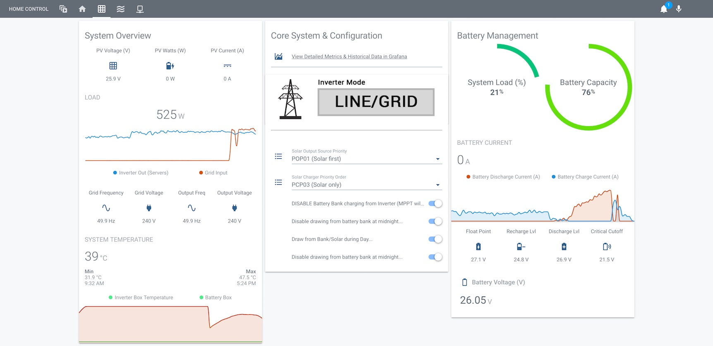
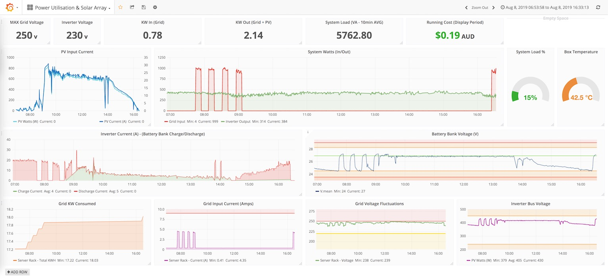
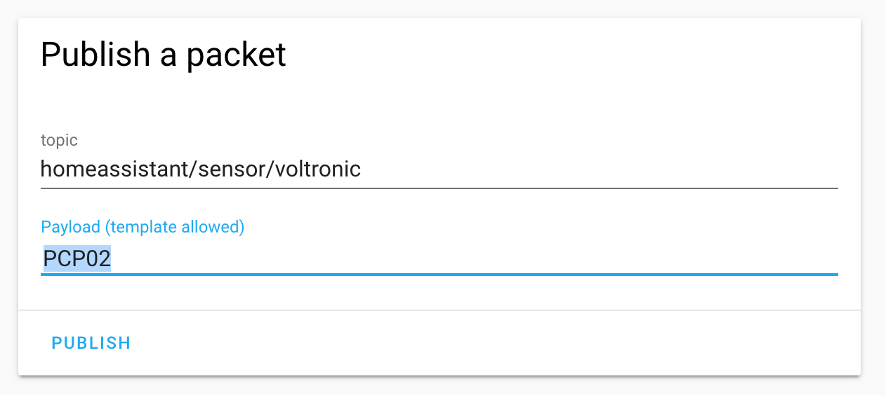

# Voltronic / MPP Solar Inverter — Home Assistant Add-on

[](LICENSE)

A Home Assistant **add-on** that monitors and controls Voltronic / Axpert / MPP Solar / Voltacon / Effekta and other OEM inverters over their RS232 or USB port, exposing grid/PV/load/battery voltages, currents, power, state-of-charge and lifetime energy counters as Home Assistant sensors (via MQTT auto-discovery). It can also send commands back to the inverter from Home Assistant.

> **Based on [ned-kelly/docker-voltronic-homeassistant](https://github.com/ned-kelly/docker-voltronic-homeassistant)**, repackaged as a native Home Assistant add-on. See [Credits](#credits) for the full lineage.

By setting values over MQTT you can build automations such as:

- Switch to _solar only_ during the day and back to _grid charging_ in the evening (or _solar + utility_ when your weather station expects clouds).
- Adjust charge/float voltages from a temperature sensor so the battery isn't charged too hard when hot or cold.
- Dynamically tune the inverter's "solar power balance".


_Example Lovelace dashboard._


_Example Grafana summary for deep-diving historical data._

## Requirements

- Home Assistant OS or Supervised (add-on support).
- The [MQTT integration](https://www.home-assistant.io/integrations/mqtt/) configured (e.g. the Mosquitto broker add-on) — the add-on requests MQTT automatically.
- A Voltronic / Axpert / MPP Solar based inverter connected to the Home Assistant host via USB or RS232.

## Install

1. **Add this repository:** Settings → Add-ons → Add-on Store → ⋮ (top right) → **Repositories** → paste
   `https://github.com/m-byte/voltronic-homeassistant` → **Add**.
2. **Install the variant** that matches how your inverter is connected:
   - **Voltronic Inverter (USB / HID)** — inverters that show up as `/dev/hidraw*` (most USB-connected Voltronic/Axpert units).
   - **Voltronic Inverter (Serial)** — RS232 or USB-serial adapters (`/dev/ttyUSB*`, `/dev/ttyS*`).
3. Open the add-on's **Configuration** tab, pick your inverter from the **device** dropdown, and adjust the other options if needed.
4. **Start** the add-on. Sensors register themselves via MQTT discovery — you don't need to define any sensors manually.

## Configuration

| Option | Default | Description |
| --- | --- | --- |
| `device` | `/dev/hidraw0` (HID) · `/dev/ttyUSB0` (Serial) | The inverter device, chosen from the dropdown (filtered to the variant's connection type). |
| `poll_interval` | `30` | Seconds between polls. Also the interval used by the per-interval watt-hour fallback. |
| `amperage_factor` | `1.0` | Multiplier to calibrate reported current against a meter. |
| `watt_factor` | `1.0` | Multiplier to calibrate reported power. |

MQTT connection details are taken automatically from Home Assistant's MQTT service.

## Sending commands to the inverter

To change inverter state, publish a command string to the inverter's primary topic (`homeassistant/sensor/<devicename>`):



_(see the [protocol manual](http://forums.aeva.asn.au/uploads/293/HS_MS_MSX_RS232_Protocol_20140822_after_current_upgrade.pdf) for the complete command list)_

```
DESCRIPTION:                PAYLOAD:  OPTIONS:
----------------------------------------------------------------
Set output source priority  POP00     (Utility first)
                            POP01     (Solar first)
                            POP02     (SBU)

Set charger priority        PCP00     (Utility first)
                            PCP01     (Solar first)
                            PCP02     (Solar and utility)
                            PCP03     (Solar only)

Set the Charge/Discharge Levels & Cutoff
                            PBDV26.9  (Don't discharge the battery unless it is at 26.9v or more)
                            PBCV24.8  (Switch back to 'grid' when battery below 24.8v)
                            PBFT27.1  (Set the 'float voltage' to 27.1v)
                            PCVV28.1  (Set the 'charge voltage' to 28.1v)

Set other commands          PEa / PDa (Enable/disable buzzer)
                            PEb / PDb (Enable/disable overload bypass)
                            PEj / PDj (Enable/disable power saving)
                            PEu / PDu (Enable/disable overload restart)
                            PEx / PDx (Enable/disable backlight)
```

_Tip: when setting charge/discharge/float/cutoff voltages, see [how to optimise charging](https://batteryuniversity.com/learn/article/charging_the_lead_acid_battery) to extend battery service life._

## Lovelace dashboard (optional)

Sample Lovelace files are in [`homeassistant/`](homeassistant/) — adapt the entity names to your inverter's name if you changed it. They rely on these custom cards:

- [vertical-stack-in-card](https://github.com/custom-cards/vertical-stack-in-card)
- [circle-sensor-card](https://github.com/custom-cards/circle-sensor-card)

## Repository layout / building

This repo is the add-on **superproject**. The poller and MQTT scripts live in a companion repo, [docker-voltronic-homeassistant](https://github.com/m-byte/docker-voltronic-homeassistant), pulled into each variant as the `common/` git submodule and compiled locally on install.

```
repository.json
voltronic-hidraw/   config.yaml   Dockerfile   common/  (submodule)
voltronic-tty/      config.yaml   Dockerfile   common/  (submodule)
```

To build/run the poller standalone (Linux / macOS / Windows via Cygwin), clone the common repo and:

```
cd sources/inverter-cli && cmake . && make

USAGE:  ./inverter_poller <args> [-r <command>], [-h | --help], [-1 | --run-once]
  -r <raw-command>   TX 'raw' command to the inverter
  -h | --help        This help message
  -1 | --run-once    Run one iteration and exit
  -d                 Additional debugging
```

## Credits

This project builds on the work of others:

- **[ned-kelly/docker-voltronic-homeassistant](https://github.com/ned-kelly/docker-voltronic-homeassistant)** — the original Home Assistant / MQTT project this add-on is forked from.
- **[manio/skymax-demo](https://github.com/manio/skymax-demo)** — the `inverter_poller` is derived from this C monitoring application ([background article](https://skyboo.net/2017/03/monitoring-voltronic-power-axpert-mex-inverter-under-linux/)).

## Related projects

- [EPEver MPPT Stats (MQTT, Docker)](https://github.com/ned-kelly/docker-epever-homeassistant)
- [LeChacal.com CT Clamp current/energy monitors](https://github.com/ned-kelly/docker-lechacal-homeassistant)
